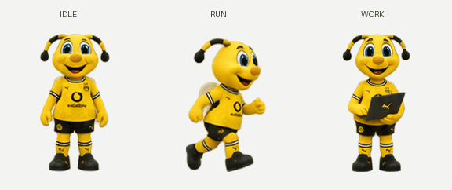

# Emma · Codex Pet

穿着 BVB 26/27 主场风格球衣的 Emma 桌宠，陪你写代码、等待任务和庆祝完成。



非官方同人作品。形象采用圆润的 3D 吉祥物风格，包含 **9 组动作、57 帧**，使用透明背景。球衣纹理与小字为风格化还原，来源与说明见 [NOTICE.md](NOTICE.md)。

## 安装

安装现成桌宠无需 Python。

1. 下载 [桌宠安装包](dist/emma-pet-2627.zip)，解压得到 `bvb-emma-2627` 文件夹。
2. 将文件夹放入 Codex 的 `pets` 目录：默认 Windows 为 `%USERPROFILE%\.codex\pets\`，macOS/Linux 为 `~/.codex/pets/`。如果配置了 `CODEX_HOME`，则使用该目录下的 `pets/`。
3. 在支持本地桌宠的 Codex 桌面版本中打开 **设置 → 宠物 → 刷新**，选择 **Emma · BVB 26/27**，输入 `/pet` 显示浮窗。实际入口以安装版本为准。

最终结构：

```text
pets/
└── bvb-emma-2627/
    ├── pet.json
    └── spritesheet.png
```

如果已下载完整仓库，也可在 PowerShell 中运行：

```powershell
./scripts/install_pet.ps1
```

脚本会验证图片哈希，并拒绝覆盖同名宠物。已有同名目录时请先自行备份或选择其他目标。

## 动作

| 状态 | 动作 | 帧数 |
| --- | --- | ---: |
| idle | 待机、眨眼 | 6 |
| running-right / running-left | 向右 / 向左移动 | 各 8 |
| waving | 挥手 | 4 |
| jumping | 跳跃 | 5 |
| failed | 失落与恢复 | 8 |
| waiting | 等待输入 | 6 |
| running | 使用电脑工作 | 6 |
| review | 检查结果 | 6 |

[查看完整帧表](preview/contact-sheet.png)

## 规格

- PNG RGBA，1536 × 1872 像素。
- v1 布局：8 列 × 9 行，每格 192 × 208 像素。
- 57 个有效帧，15 个全透明空白格。
- 不含 v2 的额外鼠标注视方向帧。
- 已验证透明通道、空白格、裁切边界和安装包一致性；应用内动作调度由 Codex 控制。

## 重建

需要 Python 3.10+。在仓库根目录运行：

```shell
python -m venv .venv
# Windows: .venv\Scripts\activate
# macOS/Linux: source .venv/bin/activate
python -m pip install -r requirements.txt
python scripts/clean_master.py
python scripts/build_pet.py
python scripts/make_showcase.py
python scripts/validate_pet.py
python scripts/package_pet.py
```

打包脚本会对现有同名 ZIP 进行一致性核对，内容一致时保留，内容不同则拒绝覆盖，可用 `--output dist/新文件名.zip` 指定新包。

`source/` 保留最终生成源图与提示词；`scripts/` 仅清理低 Alpha 残留、裁切、等比例缩放、对齐及打包。生成新形象需要另行使用图像生成工具，重建脚本本身不调用在线 API。

## 文件结构

```text
package/       可安装的元数据与帧表
preview/       动画预览与逐帧检查图
source/        最终源图与生成提示词
scripts/       构建、验证、打包、安装
dist/          可下载的安装包
validation.json  校验结果
```
